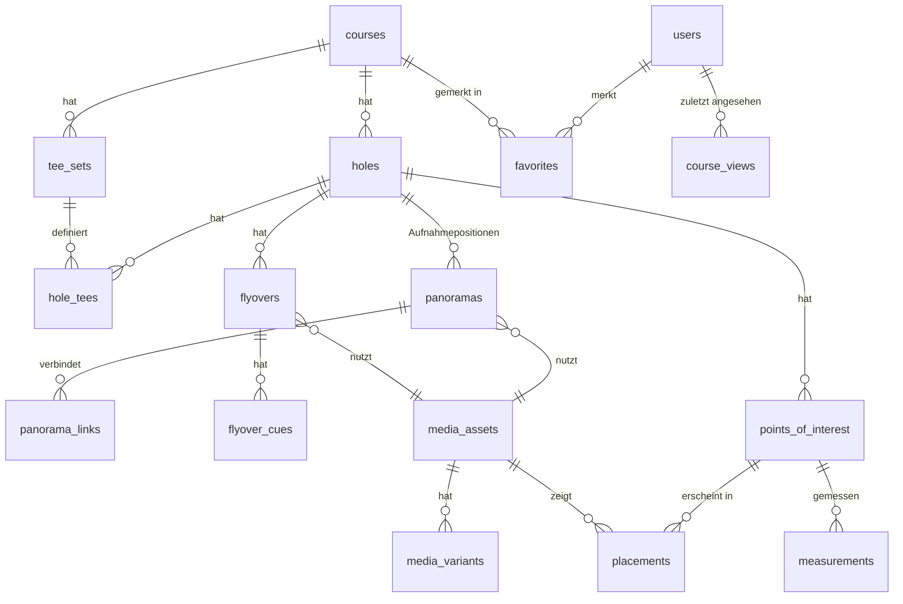

# Datenmodell – My Golf Course

Status: **Entwurf zur Freigabe** (MGC-003). Noch keine Migration existiert; Tabellen- und Feldnamen sind Vorschläge.

## Konventionen

- Tabellennamen englisch im Plural, Laravel-Konventionen (`id`, `created_at`, `updated_at`).
- **Längen und Höhen immer in Metern** (`decimal(7,2)`), Umrechnung in Yards nur in der Anzeige.
- **Koordinaten WGS84**: `lat decimal(10,7)`, `lng decimal(10,7)`, Höhe über NN `elevation_m decimal(7,2)`. Flächen/Linien als **GeoJSON** in `json`-Spalten. Keine datenbankspezifischen Geo-Typen (SQLite + MySQL kompatibel).
- Jede gemessene oder verortete Angabe trägt ihre **Genauigkeit** (`*_accuracy_m`) und **Quelle** (`*_source`), damit Nutzer sehen, wie belastbar ein Wert ist.
- Winkel in Grad: `yaw` −180…180 (0 = Bildmitte bzw. Norden nach Korrektur), `pitch` −90…90.
- Veröffentlichung über `status` (`draft`, `published`, `archived`) + `published_at`.
- Inhalte, die später übersetzt werden könnten (`name`, `description`), sind im MVP einfache Textspalten auf Deutsch. Für Mehrsprachigkeit werden sie später in JSON-Spalten (`{"de": …, "en": …}`) überführt – eine einzelne, planbare Migration.

---

## Übersicht

---

## Modul Courses

### `courses`
| Feld | Typ | Hinweis |
|---|---|---|
| id | bigint | |
| slug | string, unique | URL `/plaetze/{slug}` |
| name | string | |
| short_description | string(300) | Karten, Meta-Description |
| description | text | Markdown-light |
| club_name | string, null | Betreiberclub, falls abweichend |
| street, postal_code, city, region | string | Region für Filter (Bundesland) |
| country | char(2) | ISO 3166-1 (`DE`) |
| lat, lng | decimal | Clubhaus/Mittelpunkt, für Karte und Umkreis |
| holes_count | tinyint | 9 / 18 / 27; redundant, aber für Listen schnell |
| par_total | tinyint | |
| website_url, phone, email | string, null | |
| hero_media_id | FK media_assets, null | Luftbild/Platzübersicht |
| map_media_id | FK media_assets, null | Senkrechtes Luftbild für die Platzkarte |
| status | enum | draft, published, archived |
| published_at | timestamp, null | |
| capture_date | date, null | Wann wurde aufgenommen? (Aktualität für Nutzer) |
| meta | json, null | Erweiterungen ohne Migration (z. B. Ausstattung: Driving Range, Gastronomie) |

### `tee_sets` – Abschlagfarben eines Platzes
| Feld | Typ | Hinweis |
|---|---|---|
| course_id | FK | |
| name | string | „Gelb“, „Rot“ |
| color | enum | white, yellow, blue, red, orange, black, green, other |
| course_rating, slope | decimal / smallint, null | Herren/Damen später getrennt möglich |
| length_total_m | decimal | aus `hole_tees` summiert (Cache) |
| sort_order | tinyint | |

### `holes`
| Feld | Typ | Hinweis |
|---|---|---|
| course_id | FK | unique mit `number` |
| number | tinyint | 1–27 |
| name | string, null | Bahnname, falls der Club einen vergibt |
| par | tinyint | |
| stroke_index | tinyint, null | Handicap-Reihenfolge |
| description | text, null | Strategischer Bahntext |
| dogleg | enum | none, left, right, double |
| green_lat, green_lng | decimal, null | Grünmitte |
| green_front_m, green_depth_m | decimal, null | optional |
| green_shape | json, null | GeoJSON-Polygon |
| fairway_line | json, null | GeoJSON-LineString Abschlag → Grün (Spielidee) |
| poster_media_id | FK media_assets, null | Vorschaubild der Bahn |
| plan_media_id | FK media_assets, null | Draufsicht für den Modus „Plan“ |

### `hole_tees` – Abschlag je Bahn und Farbe
| Feld | Typ | Hinweis |
|---|---|---|
| hole_id, tee_set_id | FK | unique gemeinsam |
| length_m | decimal | offizielle Länge |
| lat, lng | decimal, null | Position des Abschlags |
| position_accuracy_m | decimal, null | |

---

## Modul Media

### `media_assets`
| Feld | Typ | Hinweis |
|---|---|---|
| id | bigint | |
| uuid | uuid, unique | öffentliche Kennung, in Dateinamen |
| type | enum | panorama, video, image, aerial |
| provider | enum | bunny_storage, bunny_stream, local |
| provider_ref | string | Pfad in der Storage-Zone bzw. Video-GUID |
| status | enum | pending, uploading, processing, ready, failed |
| original_filename | string | |
| mime_type, size_bytes | string, bigint | |
| width, height | int, null | Bilder/Panoramen |
| duration_s | decimal, null | Videos |
| projection | enum, null | equirectangular, cubemap (Panorama) |
| captured_at | timestamp, null | aus EXIF/Telemetrie |
| capture_lat, capture_lng, capture_altitude_m | decimal, null | Aufnahmeort (Drohne) |
| capture_device | string, null | z. B. Drohnenmodell |
| checksum | string | Duplikaterkennung |
| privacy_reviewed_at | timestamp, null | Personen/Kennzeichen geprüft & unkenntlich (Pflicht vor Veröffentlichung) |
| copyright, license | string, null | Bildrechte (eigene Aufnahme, Club, …) |
| meta | json | Anbieter-Antworten, EXIF-Auszug |

### `media_variants`
Fertige Auslieferungsfassungen eines Assets (Panorama 4096/8192, Kachel-Basis-URL, Poster-Größen, HLS-Playlist).

| Feld | Typ | Hinweis |
|---|---|---|
| media_asset_id | FK | |
| kind | string | `pano_4k`, `pano_8k`, `pano_tiles`, `preview`, `poster_1280`, `hls` |
| url_path | string | relativ zur CDN-Basis-URL (Domainwechsel ohne Datenmigration) |
| width, height, size_bytes | int, null | |
| meta | json, null | z. B. Kachelgröße, Zoomstufen |

---

## Modul Explorer

### `panoramas` – Aufnahmepositionen (Modus A)
| Feld | Typ | Hinweis |
|---|---|---|
| hole_id | FK | |
| media_asset_id | FK | |
| label | string | „Abschlag Gelb“, „Landezone 220 m“, „Vor dem Grün“ |
| lat, lng | decimal | Aufnahmeort |
| altitude_m | decimal | Flughöhe über Grund |
| position_accuracy_m | decimal, null | |
| heading_offset_deg | decimal | Korrektur, damit yaw 0 = Norden (im Admin justiert) |
| default_yaw, default_pitch | decimal | Startblick (meist Richtung Grün) |
| sort_order | tinyint | Reihenfolge Abschlag → Grün |
| is_start | bool | Einstieg der Bahn |

### `panorama_links` – Navigation zwischen Positionen
| Feld | Typ | Hinweis |
|---|---|---|
| from_panorama_id, to_panorama_id | FK | |
| yaw, pitch | decimal, null | **leer = automatisch aus GPS berechnen**; nur bei Bedarf manuell überschreiben |

Links zu Nachbarbahnen werden nicht gespeichert, sondern aus `holes.number ± 1` abgeleitet.

### `flyovers` – Drohnenüberflug (Modus B)
| Feld | Typ | Hinweis |
|---|---|---|
| hole_id | FK | |
| media_asset_id | FK | Video bei Bunny Stream |
| direction | enum | tee_to_green, green_to_tee |
| tee_set_id | FK, null | von welchem Abschlag gestartet |
| poster_media_id | FK, null | |
| telemetry | json, null | Später: Flugpfad aus Drohnen-Telemetrie (Zeit → Position/Höhe/Blickrichtung) |

### `flyover_cues` – Infos im Zeitverlauf
| Feld | Typ | Hinweis |
|---|---|---|
| flyover_id | FK | |
| time_start_s, time_end_s | decimal | Einblendezeitraum |
| title, body | string, text | „Fairwaybunker rechts – Carry 215 m“ |
| point_of_interest_id | FK, null | verknüpftes Objekt (Klick öffnet Details) |
| panorama_id | FK, null | „Hier umsehen“ → springt in die 360°-Position |
| pause | bool | Video an dieser Stelle anhalten |

---

## Modul Hazards

### `points_of_interest` – Objekte auf einer Bahn
| Feld | Typ | Hinweis |
|---|---|---|
| hole_id | FK | |
| type | enum | tree, tree_group, bunker_fairway, bunker_greenside, water, out_of_bounds, dogleg_corner, layup_zone, shortcut, slope, other |
| name | string | „Eiche links“, „Teich vor dem Grün“ |
| description | text, null | Strategischer Hinweis |
| lat, lng | decimal, null | Bezugspunkt (bei Flächen: Mittelpunkt) |
| elevation_m | decimal, null | Höhe über NN des Fußpunkts |
| position_accuracy_m | decimal, null | |
| position_source | enum, null | smartphone_gps, gnss_rtk, drone_photogrammetry, manual_map |
| geometry | json, null | GeoJSON Polygon/LineString (Bunkerfläche, Wasserkante) |
| importance | tinyint | 1–3: steuert, ob Marker immer, ab Zoom oder nur in der Liste erscheint |
| status | enum | draft, published |

Neue Objekttypen kommen als Enum-Wert hinzu (eine Codezeile + Übersetzung), keine Migration nötig, wenn das Enum als String gespeichert wird.

### `measurements` – Messwerte mit Historie
Ein Objekt kann mehrere Messungen haben (Neuvermessung, anderes Gerät). Angezeigt wird die jüngste gültige Messung je Größe.

| Feld | Typ | Hinweis |
|---|---|---|
| point_of_interest_id | FK | |
| quantity | enum | height, width, depth, carry_from_tee, distance_to_green |
| value_m | decimal | |
| accuracy_m | decimal | ± Wert, z. B. 0.5 |
| method | enum | laser_rangefinder, clinometer, drone_altitude, photogrammetry, estimate |
| device | string, null | Gerätemodell |
| tee_set_id | FK, null | nur bei Distanzen vom Abschlag |
| measured_at | date | |
| measured_by | FK users, null | |
| note | string, null | „Von Fairwaymitte gemessen, belaubt“ |
| superseded_at | timestamp, null | gesetzt, wenn eine neuere Messung diese ersetzt |

Beispielanzeige: **„Baumhöhe: ca. 17 m (± 1 m, gemessen 05/2027)“**. Distanzen vom Abschlag werden, wenn Koordinaten vorhanden sind, zusätzlich **berechnet** (Haversine) und als „berechnet“ gekennzeichnet; gemessene Werte haben Vorrang.

### `placements` – Wo erscheint ein Objekt in welchem Medium?
Eine Tabelle für alle Darstellungsarten, damit neue Medienarten keine neuen Tabellen brauchen.

| Feld | Typ | Hinweis |
|---|---|---|
| point_of_interest_id | FK | |
| media_asset_id | FK | Panorama, Luftbild oder Video |
| mode | enum | spherical (yaw/pitch), planar (x/y), timed (Video-Zeit) |
| yaw, pitch | decimal, null | Panorama |
| x, y | decimal, null | Bild, 0–1 relativ zur Breite/Höhe |
| time_start_s, time_end_s | decimal, null | Video |
| is_auto | bool | aus GPS berechnet (true) oder manuell gesetzt (false) |
| label_override | string, null | |

Regel: Für Panoramen mit GPS-Position wird die Platzierung **automatisch berechnet** (`is_auto = true`). Der Admin korrigiert nur Abweichungen; manuelle Werte werden bei Neuberechnung nie überschrieben.

---

## Modul Accounts / Favorites

### `users`
Struktur aus dem Marketplace übernommen (Auth, Verifizierung, Rolle, Sprache) und verschlankt:

| Feld | Typ | Hinweis |
|---|---|---|
| name, email, password, email_verified_at | | Laravel-Standard |
| role | enum | user, editor, admin |
| locale | char(2) | de, en |
| settings | json | `{"units": "m", "default_tee_color": "yellow"}` – neue Einstellungen ohne Migration |
| home_club_name | string, null | Vorbereitung Community; im MVP nur freiwillige Angabe |
| last_login_at | timestamp, null | |

### `favorites`
`user_id`, `course_id`, `created_at`; Primärschlüssel aus beiden. Später erweiterbar auf Bahnen (`favoritable` morph), im MVP bewusst nur Plätze.

### `course_views` – zuletzt angesehen
`user_id`, `course_id`, `viewed_at` (eine Zeile je Paar, wird aktualisiert); höchstens 20 je Nutzer. Gäste: nur im Browser (`localStorage`), nichts auf dem Server.

---

## Querschnitt (aus Marketplace übernommen)

`sessions`, `cache`, `jobs`, `password_reset_tokens`, `admin_audit_logs`, `security_events`.

---

## Löschregeln (DSGVO)

| Beziehung | Regel |
|---|---|
| users → favorites, course_views | `cascadeOnDelete` |
| users → measurements.measured_by | `nullOnDelete` (Messwert bleibt, Person anonym) |
| courses → holes → … | Plätze werden nicht hart gelöscht, sondern `archived`; endgültiges Löschen nur durch Admin mit Mediabereinigung |
| media_assets | Löschen entfernt Dateien beim Anbieter über einen Job; Verweise vorher prüfen |

---

## Für später vorgemerkt (nicht im MVP anlegen)

- `clubs`, `club_memberships` (Community) – `courses.club_name` wird dann zu einer Beziehung.
- `reviews` für Plätze, `rounds` / `round_participants`, `conversations` / `messages`.
- `hole_tees` getrennt nach Damen/Herren-Rating.
- Übersetzungen der Inhaltsfelder (JSON-Spalten).
